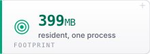
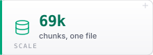
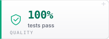
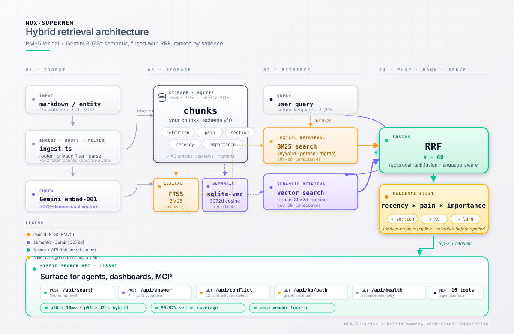

<p align="center">
  
</p>

<h1 align="center">NOX-Supermem</h1>

<p align="center"><strong>Hybrid memory for AI agents in one SQLite file &mdash; yours by design.</strong></p>

<p align="center"><em>SQLite on your disk, provider your choice, no vendor lock-in.</em></p>

<p align="center"><sub><strong>NOX-Supermem</strong> packages the <a href="https://github.com/totobusnello/memoria-nox"><code>nox-mem</code></a> engine for standalone, self-hosted use &mdash; CLI &middot; MCP server &middot; HTTP API.</sub></p>

<p align="center">
  
  
  
</p>

<p align="center">
  <a href="LICENSE"></a>
  <a href="https://github.com/totobusnello/nox-mem/stargazers"></a>
  <a href="https://github.com/totobusnello/nox-mem/actions/workflows/build.yml"></a>
  =20">
  
</p>

<p align="center">
  <picture><source media="(prefers-color-scheme: dark)" srcset="assets/readme/stat-latency-dark.svg"></picture>
  <picture><source media="(prefers-color-scheme: dark)" srcset="assets/readme/stat-footprint-dark.svg"></picture>
  <br>
  <picture><source media="(prefers-color-scheme: dark)" srcset="assets/readme/stat-scale-dark.svg"></picture>
  <picture><source media="(prefers-color-scheme: dark)" srcset="assets/readme/stat-opex-dark.svg"></picture>
  <picture><source media="(prefers-color-scheme: dark)" srcset="assets/readme/stat-tests-dark.svg"></picture>
</p>

<p align="center">
  <a href="#%EF%B8%8F-how-it-works">🏗️ How it works</a> &middot;
  <a href="#-install">🚀 Install</a> &middot;
  <a href="#-step-by-step--for-humans">👤 Humans</a> &middot;
  <a href="#-step-by-step--for-agents-openclaw--hermes--others">🤖 Agents</a> &middot;
  <a href="#-the-numbers">📊 Numbers</a> &middot;
  <a href="#-publications">📚 Publications</a>
</p>

Long-term memory engine that any agent (OpenClaw, Hermes, Claude Code, custom) can use to *remember decisions, search past context, and never ask "where were we?" again.* The engine lives in [`nox-mem/`](./nox-mem) and ships with **no data** — your memory starts empty.

<p align="center">
  
  <br>
  <sub>Real terminal — <code>stats</code> · hybrid <code>search</code> · <code>reflect</code> (RAG with cited sources) · HTTP API for agents.</sub>
</p>

---

## 🏗️ How it works

<p align="center">
  <picture>
    <source media="(prefers-color-scheme: dark)" srcset="assets/readme/architecture-dark.svg">
    
  </picture>
</p>

**Five layers, one SQLite file:**

1. **Ingest** — router auto-detects entity files (`compiled` / `frontmatter` / `timeline` sections), plain markdown, or graphify input. A privacy filter applies redaction patterns before anything is stored.
2. **Store** — chunks land in SQLite with an FTS5 index plus a 3072-d Gemini vector via `sqlite-vec`. Each chunk carries a typed retention window (`feedback`/`person`/`distilled` none, `lesson` 180d, `decision`/`project` 365d, default 90d), used only as the recency half-life in the salience score (`NOX_SALIENCE_MODE`, `shadow` by default); nothing is deleted by age.
3. **Retrieve** — the query runs in parallel through FTS5 BM25 and Gemini semantic; **RRF fusion (k=60)** merges them. (Language-aware RRF weights were measured in the research harness and are not in this package.)
4. **Rank** — a section boost for entity files, plus a **salience** score (weighted sum: importance 0.55, recency 0.15, pain 0.10, access 0.20) that is computed in `shadow` mode by default and only changes the order with `NOX_SALIENCE_MODE=active`. Dates act as hard filters (`--as-of`, `--changed-since`), not as a boost. *Shadow discipline:* ranking changes run in shadow for 7 days before they touch a live query.
5. **Answer** — CLI, MCP, and HTTP surfaces with citation footers and an anti-hallucination guard.

Copy the SQLite file, you copy the memory. Switch the embedding provider, the store doesn't care.

---

## 🚀 Install

Pick your interface — same engine, one SQLite file behind all three:

| Interface | Entry point | Best for |
|---|---|---|
| **CLI** | `nox-mem <cmd>` | humans, scripts, cron |
| **MCP server** | `nox-mem-mcp` | **agents** (OpenClaw, Hermes, Claude Code) — 22 tools |
| **HTTP API** | `nox-mem-api` | services, dashboards, remote agents |

**Prerequisites (Linux / macOS):** Node 20+. `build-essential` and `python3` only matter if `better-sqlite3` cannot download a prebuilt binary for your platform and has to compile (`inotify-tools` is not needed).

```bash
node --version   # must be >= 20
# Debian/Ubuntu, only if the install below asks for a compiler:
sudo apt-get update && sudo apt-get install -y build-essential python3
```

### ⚡ Quick install (copy-paste)

```bash
npm install -g nox-mem                           # published on npm — that's the whole install

export GEMINI_API_KEY=AIza...                    # https://aistudio.google.com/apikey

nox-mem stats                                    # first run creates ~/.nox-mem/nox.db
nox-mem ingest notes/*.md                        # one or many files
nox-mem search "hello"
```

### 👤 Step by step — for humans

**1. Install** — from npm (easiest), or from source if you want the agent profiles/templates too:

```bash
# From npm (recommended)
npm install -g nox-mem
nox-mem --help

# …or from source (also gets perfis/ + templates/)
git clone https://github.com/totobusnello/nox-mem.git
cd nox-mem/nox-mem && npm ci && npm run build && npm install -g .
```

**2. Configure** — create a `.env` (template in [`nox-mem/.env.example`](./nox-mem/.env.example)):

```bash
# Required
GEMINI_API_KEY=AIza...                 # Google AI Studio key

# Optional
NOX_DB_PATH=$HOME/.nox-mem/nox.db      # SQLite database; this is already the default (missing folder is created)
# NOX_MEM_DIR is NOT your notes folder: it only sets where pre-op snapshots go
# ($NOX_MEM_DIR/.nox-snapshots) and widens the op-audit allowlist. Leave it unset.

# HTTP API (optional) — default port 18802
NOX_API_PORT=18802
NOX_API_HOST=127.0.0.1
# NOX_API_TOKEN=change-me              # if set, API requires Authorization: Bearer <token>
```

Load it before running the CLI in any shell, cron, or service:

```bash
set -a; source "$HOME/.nox-mem/.env"; set +a
```

> ⚠️ Without sourcing the env, `vectorize`/`kg-*` fail **silently** ("Done: 0 embedded").

**3. Initialize & verify**

```bash
nox-mem stats     # first run auto-creates the schema — no migrations to run
nox-mem doctor    # diagnostic: SQLite, FTS5, vector extension, config
```

**4. Ingest, embed, search**

```bash
nox-mem ingest notes/*.md            # plain markdown is fine; one or many files
nox-mem vectorize                    # embeds new chunks (needs GEMINI_API_KEY)
nox-mem search "what did we decide about pricing"
nox-mem primer                       # ~500-token context-recovery summary

# keep indexing a folder as you save into it (absolute paths, comma-separated)
NOX_WATCH_DIRS="$HOME/notes" nox-mem watch
```

A directory passed to `ingest` is an error naming it (the other files still run, exit 1). Past 10,000 chunks `ingest` and `watch` ask you to confirm: `--allow-prod` or `NOX_ALLOW_PROD_INGEST=1`. That guard stops a test script from writing into your real database by accident.

### 🤖 Step by step — for agents (OpenClaw / Hermes / others)

Agents connect over **MCP** (preferred) or the **HTTP API**. The bootstrap is idempotent — each step verifies before continuing.

**1. Deterministic bootstrap** (run in order; stop on first failure)

```bash
# preconditions
node --version | grep -qE 'v(2[0-9]|[3-9][0-9])' || { echo "need Node >=20"; exit 1; }

# install from npm
npm install -g nox-mem

# config
export GEMINI_API_KEY="<key>" NOX_DB_PATH="/data/nox/nox.db"   # the folder is created if missing

# verify schema
nox-mem stats | grep -q "Chunks:" || { echo "schema init failed"; exit 1; }

# the MCP server is a bin on PATH
command -v nox-mem-mcp || { echo "nox-mem-mcp not on PATH"; exit 1; }
```

**2. Wire it as an MCP server** (recommended) — 22 tools (`nox_mem_search`, `nox_mem_get`, `nox_mem_answer`, `nox_mem_ingest`, `nox_mem_primer`, `nox_mem_reflect`, `nox_mem_kg_query`, `nox_mem_decision_*`, `nox_mem_cross_search`, …). Add to your agent's MCP config (Claude Code `.mcp.json`, OpenClaw/Hermes equivalent):

```json
{
  "mcpServers": {
    "nox-mem": {
      "command": "nox-mem-mcp",
      "env": {
        "GEMINI_API_KEY": "AIza...",
        "NOX_DB_PATH": "/data/nox/nox.db"
      }
    }
  }
}
```

Or in one line for Claude Code: `claude mcp add nox-mem -e GEMINI_API_KEY="$GEMINI_API_KEY" -e NOX_DB_PATH=/data/nox/nox.db -- nox-mem-mcp`.

Temporal filters work on every surface: `nox_mem_search` and `nox_mem_answer` take `as_of` / `changed_since` (on the CLI, `--as-of` / `--changed-since`; over HTTP, `?as_of=` / `?changed_since=` on `/api/search` and the same keys in the `POST /api/answer` body). A bad or blank date gives exit 2 / HTTP 400 / MCP `isError`.

The agent calls `nox_mem_search` to recall and `nox_mem_ingest` to store. Over MCP each search hit comes with its chunk id and whole text (up to 24,000 characters per call; a hit cut by that budget says so, and `nox_mem_get` returns it whole). The CLI keeps its 200-character preview. Run `nox_mem_primer` at session start for context recovery. Reusable agent profiles (`assistente-pessoal`, `financeiro`, `pesquisador`) live in [`perfis/`](./perfis); generic SOUL/HEARTBEAT/IDENTITY templates in [`templates/`](./templates).

**3. Or wire it as an HTTP API**

```bash
set -a; source /data/nox/.env; set +a
nox-mem-api                                             # listens on 127.0.0.1:18802 (NOX_API_PORT overrides)
```

| Endpoint | Purpose |
|---|---|
| `GET /api/health` | status + `vectorCoverage` (`{embedded, total, orphans, indexOnly}`) |
| `GET /api/search?q=...` | hybrid search |
| `GET /api/brief` | salience-ranked session priming |
| `POST /api/answer` | RAG answer over memory (body accepts `as_of` / `changed_since`) |
| `GET /api/kg`, `/api/kg/path` | knowledge graph |
| `GET /api/reflect?q=...` | synthesis over memory + KG (`q` is required; 400 without it) |

If `NOX_API_TOKEN` is set, send `Authorization: Bearer <token>`.

---

## 📊 The numbers

Every number below is from the nox-mem technical report ([doi:10.5281/zenodo.23147633](https://doi.org/10.5281/zenodo.23147633)) and was measured with the research harness in [`memoria-nox`](https://github.com/totobusnello/memoria-nox), not with this package on its own (see [REPRODUCE.md](REPRODUCE.md)). Results that go against nox-mem are reported next to the ones that favour it.

### Retrieval against five memory systems

A comparison planned and committed before the first run: the same corpus (6,830 LoCoMo and LongMemEval passages), the same 2,482 questions, each system at its documented default, scored by nDCG@10 at k = 10.

| System | Overall nDCG@10 | LoCoMo | LongMemEval | p50 latency |
|---|---:|---:|---:|---:|
| EverOS 1.3.1 (with a mandatory 4B re-ranker) | **0.6455** | **0.6585** | **0.5942** | 1,592 ms |
| **nox-mem** (no re-ranker) | 0.5013 | 0.4952 | 0.5255 | 515.6 ms |
| Zep 0.27.2 | 0.4546 | 0.4793 | 0.3567 | 6,002 ms |
| Mem0 (on nox-mem's embedder) | 0.4331 | 0.4407 | 0.4030 | 349.8 ms |

- **EverOS leads** on both datasets. Its pipeline cannot run without a cross-encoder re-ranker and nox-mem has none; the gap is not attributed to the re-ranker, because that was not measured.
- **The embedder decides the order between nox-mem and Mem0.** With each system on its own default embedder (100 questions per dataset), Mem0 wins LoCoMo (0.4686 vs 0.4263) and nox-mem wins LongMemEval (0.5234 vs 0.4764). With both on `gemini-embedding-001` at 3072 dimensions, nox-mem leads on both datasets with disjoint confidence intervals.
- Letta (about 16 minutes per query) and agentmemory did not produce full-set numbers; the report gives the reasons.
- Latencies are from this harness and are not normalized for transport, so they are not a cross-system latency comparison.

### Agent-memory benchmark (EverMemBench)

LLM-judged answers, five batches (3,121 queries), top-k = 20, no re-ranker, against the MemOS row of the benchmark paper on the **same** reader model.

| Reader model | nox-mem Overall | MemOS | Δ |
|---|---:|---:|---:|
| Gemini-3-flash | 63.28% | 59.27% | +4.01 pp |
| GPT-4.1-mini | 51.68% | 42.55% | +9.13 pp |

- **Multi-hop is a loss:** 6.02% against 10.84% for MemOS on Gemini-3-flash, and 3.21% against 18.88% on GPT-4.1-mini.
- On Gemini-3-flash the full-context baseline reaches 72.61%, above both memory systems, so this is not a state-of-the-art result.
- The benchmark was published by the vendor of EverOS.

### What the ranking signals do

On a 100-query golden set, almost all of the ranking gain comes from section-aware ranking of entity files: with only the section boost on, nDCG@10 is 0.6228, 99.86% of the full stack. The severity ("pain") term has no measured effect: Δ = +0.0065 nDCG@10, 95% CI [−0.0143, +0.0338], n = 31. It stays in the salience score as one weight among four.

### Production characteristics

Measured on the production host on 2026-05-29 (4 vCPU, 16 GB, six agents, 69,135 chunks).

| Dimension | nox-mem |
|---|---:|
| Hybrid search (BM25 + dense + RRF) | 529 ms p50, 744 ms p99 |
| Knowledge-graph path (`GET /api/kg/path`, no model call) | 2.5 ms p50 |
| Resident memory | 399 MB idle, 423 MB at ten concurrent requests |
| Services and mandatory third-party keys | 1 process, 0 keys (embeddings optional) |
| Cost per hybrid query | one embedding call, about $1.50 per million queries |

<sub>
For comparison, from each project's own documentation and not measured by us: Mem0 runs Postgres and Qdrant and needs an OpenAI key; Zep runs Zep and Postgres and does not start without a paid LLM key; EverOS's docker-compose runs MongoDB, Elasticsearch, Milvus, Redis and Postgres. <b>&lt; $11/mo</b> in the header assumes the cheapest Hostinger VPS and the Google AI Studio free tier.
</sub>

---

## 📚 Publications

The technical report describes the system and the comparison above: *nox-mem* technical report, Zenodo, [doi:10.5281/zenodo.23147633](https://doi.org/10.5281/zenodo.23147633). The studies that followed it (evaluation on a Portuguese agent memory, construction of memory by LLMs, knowledge-graph repair, whether agents consult their memory) are listed with their DOIs in the [`memoria-nox` README](https://github.com/totobusnello/memoria-nox#other-publications-from-this-repository) and at [labf.bio/research](https://labf.bio/research/). None is peer reviewed.

---

## 🔌 Multi-provider

Default is **Gemini via Google AI Studio** for both LLM and embeddings (`GEMINI_API_KEY`). The **RAG answer/reflect layer and embeddings** are provider-pluggable at runtime — no rebuild:

- **LLM** (`NOX_LLM_PROVIDER`) — `gemini` (default) or `openai`, where `openai` drives **any OpenAI-compatible endpoint**: OpenAI, DeepSeek, OpenRouter, Together, or a local Ollama/vLLM. `anthropic` is interface-ready but **not yet implemented**.
- **Embedding** (`NOX_EMBEDDING_PROVIDER`) — `gemini` (default, 3072-d) or `openai` (any OpenAI-compatible embeddings endpoint). `voyage` is interface-ready but **not yet implemented**.

```bash
# DeepSeek LLM + OpenAI embeddings (both OpenAI-compatible)
NOX_LLM_PROVIDER=openai
NOX_LLM_BASE_URL=https://api.deepseek.com/v1
NOX_LLM_MODEL=deepseek-chat
NOX_LLM_API_KEY=sk-...

NOX_EMBEDDING_PROVIDER=openai
NOX_EMBEDDING_BASE_URL=https://api.openai.com/v1
NOX_EMBEDDING_MODEL=text-embedding-3-large
NOX_EMBEDDING_DIM=3072        # MUST equal the vec0 table dim
NOX_EMBEDDING_API_KEY=sk-...
```

> ℹ️ **Scope of provider routing today:** the RAG answer layer (`reflect` / `/api/answer`) and embeddings honor the env vars above. Some internal LLM operations — knowledge-graph extraction, consolidation, digest, and query expansion — still call Gemini directly and require `GEMINI_API_KEY` even when another provider is set. Routing every path through the provider layer is on the roadmap.

> ⚠️ **Dimension lock:** the sqlite-vec table is created with a fixed dimension. Switching embedding provider or model requires re-embedding the **entire corpus** with a single model at a single dimension matching the `vec0` table. `text-embedding-3-large` supports `dimensions=3072` (same as the default Gemini table). Vectors from different models are not comparable — mixing silently corrupts semantic search. Full env reference: [`nox-mem/README.md`](./nox-mem/README.md).

---

## 🩺 Verify & troubleshoot

```bash
nox-mem-api &
curl -s "http://127.0.0.1:${NOX_API_PORT:-18802}/api/health" | jq '.vectorCoverage | .embedded/.total'
# close to 1.0 = all chunks embedded; below 0.99 → run `nox-mem vectorize`
```

| Symptom | Fix |
|---|---|
| `vectorize` says "0 embedded" | env not sourced — `set -a; source .env; set +a` |
| `vec0 ... cannot open shared object` | platform binary missing — reinstall `nox-mem` (`npm i -g nox-mem`) so npm fetches `sqlite-vec-<os>-<arch>`; installing `sqlite-vec` by itself does not help |
| `better-sqlite3` build error | install `build-essential` + `python3`, then `npm ci` again |
| API port in use | set `NOX_API_PORT` (default is 18802) |
| `ingest` aborts with "Large-DB ingest guard" | the database has more than 10,000 chunks: pass `--allow-prod` or set `NOX_ALLOW_PROD_INGEST=1` (or point `NOX_DB_PATH` at another file if it is the wrong database) |
| `nox-mem watch` says "Watching 0 directories" | set `NOX_WATCH_DIRS` to your notes folder (absolute path) |
| `reindex` refuses or finds "0 files" | `reindex` rebuilds from `$OPENCLAW_WORKSPACE/memory` and `/shared`, not from your notes; on a standalone install use `nox-mem ingest` |
| path rejected by op-audit guard | set `NOX_OP_AUDIT_ALLOWED_PREFIXES`, or keep DB under `NOX_DB_PATH`/`NOX_MEM_DIR` (auto-allowed) |

Full env-var reference and per-command notes: **[`nox-mem/README.md`](./nox-mem/README.md)**.

---

## License

MIT © 2026 Luiz Antonio Busnello (Toto). Use it, fork it, ship it.
